  

  
  
  

<picture>
  <source media="(prefers-color-scheme: dark)" srcset="assets/heading-about-dark.svg">
  
</picture>

**Xin chào!** I'm Nghĩa, an IT student at PTIT in Hà Nội.

Most of my time goes into **Ironfront: Reborn**, a multiplayer FPS where the netcode is the whole point. Raw TCP and UDP sockets, no Mirror, no Photon, and a wire protocol I froze in week one.

The rest goes to AI work that has to run somewhere real: RAG and GraphRAG over Vietnamese property listings, and machine learning apps with a REST API, a web client and a mobile app behind them. With friends, I also fly a quadcopter from a ground station we wrote ourselves.

I once wrote Snake in 8086 assembly. I don't recommend it.

Happy to talk about sockets, Unity, C# or Python.

 

<picture>
  <source media="(prefers-color-scheme: dark)" srcset="assets/heading-toolbox-dark.svg">
  
</picture>

<picture>
  <source media="(prefers-color-scheme: dark)" srcset="assets/heading-projects-dark.svg">
  
</picture>

  
  
  
  

  
  
  

<picture>
  <source media="(prefers-color-scheme: dark)" srcset="assets/heading-garden-dark.svg">
  
</picture>

<picture>
  <source media="(prefers-color-scheme: dark)" srcset="https://raw.githubusercontent.com/Nghaiz/Nghaiz/output/snake-dark.svg">
  
</picture>

Image credits and how this page is made

The scenes are stills and fanart from Makoto Shinkai's films. All rights stay with their owners; they are used here as fan tribute, with credit.

- Header: *Your Name* (君の名は。) fanart by [画师JW](https://www.pixiv.net/artworks/89578796)
- About: *Suzume* (すずめの戸締まり) © 2022 “Suzume” Film Partners / CoMix Wave Films
- Stats banner and footer: *Weathering With You* (天気の子) © 2019 “Weathering With You” Film Partners / CoMix Wave Films

The motion on top of them (comet, stars, rain, light) and every card on this page are generated SVGs. `npm run build` redraws the art from [`scripts/profile.config.mjs`](scripts/profile.config.mjs), and a daily GitHub Action refreshes the stats cards with `npm run stats`. Fonts: Gentium Book Plus, Patrick Hand, Klee One and Yuji Syuku (SIL Open Font License).

