  

  
  
  
  
   
  
  
  

<picture>
  <source media="(prefers-color-scheme: dark)" srcset="assets/heading-about-dark.svg">
  
</picture>

**Xin chào!** I'm Nghĩa, an IT student at PTIT in Hà Nội.

I started out writing software, and I still do. These days I care just as much about what happens after the code is written: how it gets built, tested, shipped and kept running. That's the road I'm on, **from software engineer toward DevOps and Cloud**.

So far on that road: CI pipelines on GitHub Actions with build gates that refuse a bad merge, a Jenkins job that pushes builds through an API, Docker for the services I deploy, and a DevOps learning platform I'm building on the side. Next up: Kubernetes, Terraform and running things on a real cloud.

University gave me the rest: a multiplayer FPS netcode on raw TCP/UDP, RAG over Vietnamese property data, a drone ground station. I once wrote Snake in 8086 assembly. I don't recommend it.

 

<picture>
  <source media="(prefers-color-scheme: dark)" srcset="assets/heading-stack-dark.svg">
  
</picture>

<picture>
  <source media="(prefers-color-scheme: dark)" srcset="assets/label-devops-dark.svg">
  
</picture>

   
  

<picture>
  <source media="(prefers-color-scheme: dark)" srcset="assets/label-building-dark.svg">
  
</picture>

   
  

<picture>
  <source media="(prefers-color-scheme: dark)" srcset="assets/heading-projects-dark.svg">
  
</picture>

  
  
  
  

  
  
  
  

<picture>
  <source media="(prefers-color-scheme: dark)" srcset="assets/heading-graph-dark.svg">
  
</picture>

<picture>
  <source media="(prefers-color-scheme: dark)" srcset="https://raw.githubusercontent.com/Nghaiz/Nghaiz/output/snake-dark.svg">
  
</picture>

Image credits and how this page is made

 

The scenes are stills and fanart from Makoto Shinkai's films. All rights stay with their owners; they are used here as a fan tribute, with credit.

- **Header:** *Your Name* (君の名は。) fanart by [画师JW](https://www.pixiv.net/artworks/89578796)
- **About and stats banner:** *Your Name* (君の名は。) © 2016 TOHO / CoMix Wave Films
- **Footer:** *Weathering With You* (天気の子) © 2019 “Weathering With You” Film Partners / CoMix Wave Films

The motion on top of them (comet, rain, aviation lights, sunlight), the badges and every card here are generated SVGs. `npm run build` redraws them from [`scripts/profile.config.mjs`](scripts/profile.config.mjs), and GitHub Actions refresh the badges, the stats cards, the 3D calendar and the snake every day.

Fonts: Fuzzy Bubbles, Shippori Mincho B1 and Montserrat Alternates (SIL Open Font License). Icons: [skillicons.dev](https://skillicons.dev).

