

  

  
  
  

<picture>
  <source media="(prefers-color-scheme: dark)" srcset="assets/heading-about-dark.svg">
  
</picture>


**Xin chào!** I'm Nghĩa, an IT student at PTIT in Hà Nội.

Most of my time goes into **Ironfront: Reborn**, a multiplayer FPS where the netcode is the whole point. Raw TCP and UDP sockets, no Mirror, no Photon, and a wire protocol I froze in week one.

The rest goes to AI work that has to run somewhere real: RAG and GraphRAG over Vietnamese property listings, and machine learning apps with a REST API, a web client and a mobile app behind them. With friends, I also fly a quadcopter from a ground station we wrote ourselves.

I once wrote Snake in 8086 assembly. I don't recommend it.

 

<picture>
  <source media="(prefers-color-scheme: dark)" srcset="assets/heading-stack-dark.svg">
  
</picture>

   
  

<picture>
  <source media="(prefers-color-scheme: dark)" srcset="assets/heading-projects-dark.svg">
  
</picture>

  <a href="https://github.com/Nghaiz/LTM"></a>
  <a href="https://github.com/ngtukien/IOT-CV"></a>
  <a href="https://github.com/ngtukien/Vietnam-Real-Estates"></a>
  <a href="https://github.com/Nghaiz/Intelligent-System-Development"></a>

  
  
  
  

<picture>
  <source media="(prefers-color-scheme: dark)" srcset="assets/heading-graph-dark.svg">
  
</picture>

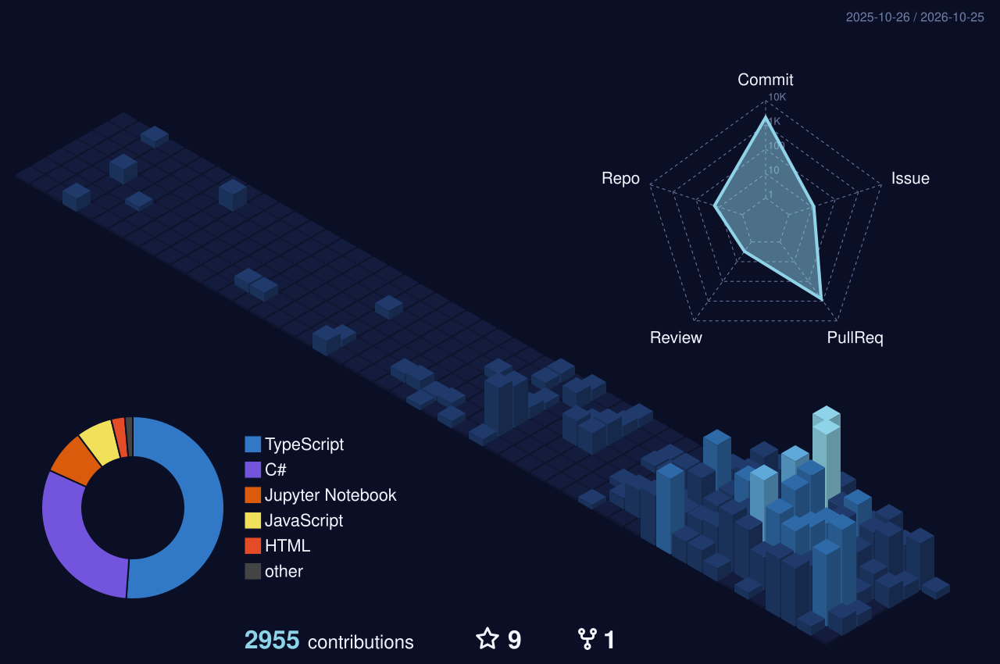

<picture>
  <source media="(prefers-color-scheme: dark)" srcset="https://raw.githubusercontent.com/Nghaiz/Nghaiz/output/snake-dark.svg">
  
</picture>


Image credits and how this page is made

The scenes are stills and fanart from Makoto Shinkai's films. All rights stay with their owners; they are used here as a fan tribute, with credit.

- Header: *Your Name* (君の名は。) fanart by [画师JW](https://www.pixiv.net/artworks/89578796)
- About and stats banner: *Your Name* (君の名は。) © 2016 TOHO / CoMix Wave Films
- Footer: *Weathering With You* (天気の子) © 2019 “Weathering With You” Film Partners / CoMix Wave Films

The motion on top of them (comet, rain, aviation lights, sunlight) and every card here are generated SVGs. `npm run build` redraws them from [`scripts/profile.config.mjs`](scripts/profile.config.mjs); GitHub Actions refresh the stats cards, the 3D calendar and the snake every day. Fonts: Fuzzy Bubbles, Montserrat Alternates and Shippori Mincho B1 (SIL Open Font License). Icons: [skillicons.dev](https://skillicons.dev).

