

  

  
  
  
  
   
  
  
  

<picture>
  <source media="(prefers-color-scheme: dark)" srcset="assets/heading-about-dark.svg">
  
</picture>

**Xin chào!** I'm Nghĩa, an IT student at PTIT in Hà Nội.

I started out writing software, and I still do. These days I care just as much about what happens after the code is written: how it gets built, tested, shipped and kept running. That's the road I'm on, **from software engineer toward DevOps and Cloud**.

So far on that road: CI pipelines on GitHub Actions with gates that refuse a bad merge, Docker images built and pushed from CI, Kubernetes and Helm for a DevOps learning platform I'm building on the side, Terraform, and security scans (Trivy, gitleaks, CodeQL) wired into the pipelines. Next up: running all of it on a real cloud.

University gave me the rest: a multiplayer FPS netcode on raw TCP/UDP, RAG over Vietnamese property data, a drone ground station. I once wrote Snake in 8086 assembly. I don't recommend it.

 

<picture>
  <source media="(prefers-color-scheme: dark)" srcset="assets/heading-stack-dark.svg">
  
</picture>

  <picture><source media="(prefers-color-scheme: dark)" srcset="assets/stack-languages-dark.svg"></picture>
  <picture><source media="(prefers-color-scheme: dark)" srcset="assets/stack-apps-dark.svg"></picture>
  <picture><source media="(prefers-color-scheme: dark)" srcset="assets/stack-backend-dark.svg"></picture>
  <picture><source media="(prefers-color-scheme: dark)" srcset="assets/stack-data-dark.svg"></picture>
  <picture><source media="(prefers-color-scheme: dark)" srcset="assets/stack-devops-dark.svg"></picture>
  <picture><source media="(prefers-color-scheme: dark)" srcset="assets/stack-stores-dark.svg"></picture>

<picture>
  <source media="(prefers-color-scheme: dark)" srcset="assets/heading-projects-dark.svg">
  
</picture>

  <a href="https://github.com/Nghaiz/LTM"><picture><source media="(prefers-color-scheme: dark)" srcset="assets/project-ironfront-dark.svg"></picture></a>
  <a href="https://github.com/ngtukien/IOT-CV"><picture><source media="(prefers-color-scheme: dark)" srcset="assets/project-drone-dark.svg"></picture></a>
  <a href="https://github.com/ngtukien/Vietnam-Real-Estates"><picture><source media="(prefers-color-scheme: dark)" srcset="assets/project-realestate-dark.svg"></picture></a>
  <a href="https://github.com/Nghaiz/Intelligent-System-Development"><picture><source media="(prefers-color-scheme: dark)" srcset="assets/project-intelligent-dark.svg"></picture></a>

  <picture><source media="(prefers-color-scheme: dark)" srcset="assets/generated/overview-dark.svg"></picture>
  <picture><source media="(prefers-color-scheme: dark)" srcset="assets/generated/languages-dark.svg"></picture>
  <picture><source media="(prefers-color-scheme: dark)" srcset="assets/generated/streak-dark.svg"></picture>
  <picture><source media="(prefers-color-scheme: dark)" srcset="assets/generated/activity-dark.svg"></picture>
  <picture><source media="(prefers-color-scheme: dark)" srcset="assets/generated/trophies-dark.svg"></picture>

<picture>
  <source media="(prefers-color-scheme: dark)" srcset="assets/heading-graph-dark.svg">
  
</picture>

<picture>
  <source media="(prefers-color-scheme: dark)" srcset="https://raw.githubusercontent.com/Nghaiz/Nghaiz/output/snake-dark.svg">
  
</picture>

Image credits and how this page is made

 

The scenes are stills and fanart from Makoto Shinkai's films. All rights stay with their owners; they are used here as a fan tribute, with credit.

- **Header:** *Your Name* (君の名は。) fanart by [画师JW](https://www.pixiv.net/artworks/89578796)
- **About, stats banner and the night polaroid:** *Your Name* (君の名は。) © 2016 TOHO / CoMix Wave Films
- **Footer:** *Weathering With You* (天気の子) © 2019 “Weathering With You” Film Partners / CoMix Wave Films

Everything else is generated SVG: the motion on the scenes, the journal cards, the doodle stickers (drawn by hand in code) and the badges. `npm run build` redraws them from [`scripts/profile.config.mjs`](scripts/profile.config.mjs) and [`scripts/stack.config.mjs`](scripts/stack.config.mjs), and GitHub Actions refresh the badges, the stats cards, the achievements, the 3D calendar and the snake every day. Each card has a night-journal and a cream-paper version that follows your GitHub theme. The achievement ranks borrow their idea from [github-profile-trophy](https://github.com/ryo-ma/github-profile-trophy).

Fonts: Fuzzy Bubbles, Klee One, Shippori Mincho B1 and Montserrat Alternates (SIL Open Font License). Logos: [devicon](https://devicon.dev) (MIT).

